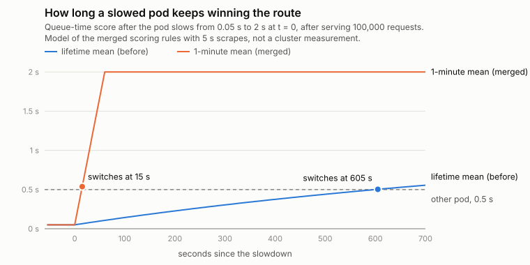

# Routing on stale latency: a lifetime average in AIBrix's least-latency router

**Status:** merged upstream as [vllm-project/aibrix#3327](https://github.com/vllm-project/aibrix/pull/3327) (merge commit `48cf8309ad`, 2026-10-30), from my issue [#3297](https://github.com/vllm-project/aibrix/issues/3297). Checked 2026-10-31.
**Scope of the evidence:** unit tests and a model of the merged scoring rules. No live-cluster measurement; see [Limitations](#limitations).

## Summary

AIBrix's least-latency router sends each request to the pod with the lowest expected latency. It estimated that latency from vLLM's histograms, which are cumulative since the engine started, so every score was a lifetime average. A pod that had served 100,000 fast requests and then built a backlog kept winning the route for about 10 minutes, because new slow requests barely move a mean over 100,000 old ones. The time grows linearly with the pod's uptime.

The merged change scores pods by the mean over about the last minute, computed from two scrapes of the same histogram, with fallbacks for quiet pods, young pods and engine restarts. In the model below, the time until the router reacts drops from 10 s / 65 s / 605 s / 6,005 s (for pods that had served 1,000 to 1,000,000 requests) to 15 s for all of them.



## 1. How the router scored pods

`least-latency` ([latency.go#L124-L148](https://github.com/vllm-project/aibrix/blob/a80f119d33b8ace3814b3900d49f1c6a390cd6ef/pkg/plugins/gateway/algorithms/least/latency.go#L124-L148), before the change) scores a pod as mean queue time plus token-weighted mean prefill and decode time, and routes to the lowest score. Each mean came from `GetMean()` on a histogram the gateway scrapes from the engine:

```go
queuingLatency := queuingLatencyHistogram.GetMean() // Sum / Count since engine start
```

The same pattern was in two other places: the LoRA `leastLatencyScheduler` and the PD prefill scorer's `getAvgPrefillTimeMs`. The docs describe the strategy as routing to "the pod with the lowest recent latency".

## 2. Why a lifetime mean goes stale

After a pod has served N requests with queue time q₀, it starts queueing for Q per request. After k slow requests its lifetime mean is (N·q₀ + k·Q) / (N + k). The router keeps choosing it while that is below the other pod's q₂, which takes

k* = N · (q₂ − q₀) / (Q − q₂)

slow requests. An outside contributor, ptimizeroracle, derived and measured this on the issue. k* is linear in N: the older the pod, the longer the router ignores a backlog. With q₀ = 0.05 s, Q = 2 s, q₂ = 0.5 s, k* = 0.3·N, so at 50 req/s a pod with 100,000 requests behind it keeps winning for 600 s.

The issue's reproduction feeds both views of the same two pods to the real router on `main`:

```
cumulative (today): scores p1=2.641 s, p2=2.700 s -> routes to 1.1.1.1:8000
last minute:        scores p1=22.200 s, p2=2.700 s -> routes to 2.2.2.2:8000
```

p1's last 200 requests waited 20 s each, but its lifetime mean queue time only moved from 0.05 s to 0.44 s.

## 3. The merged design

The gateway already had the machinery for a windowed quantity: `calculateRate1m` turns cumulative counters into a per-second rate from snapshots about a minute apart. A histogram's Sum and Count are both counters, so the mean over the window is

recent mean = (Sum_now − Sum_base) / (Count_now − Count_base)

which is what Prometheus users write as `rate(x_sum[1m]) / rate(x_count[1m])`.

[`pkg/cache/recent_mean.go`](https://github.com/vllm-project/aibrix/blob/48cf8309ad/pkg/cache/recent_mean.go):

- On every scrape, for the queue, prefill, decode and inference-time histograms, the cache appends a (Sum, Count, time) snapshot (throttled to one per 5 s, at most 36 / 3 minutes) and picks as base the snapshot closest to now − 1 minute. These are the same helpers `calculateRate1m` uses, now shared (`appendSnapshot1m`, `baseSnapshot1m`) so both quantities have one definition of "the last minute".
- The result is stored as a derived pod-model metric, `<histogram>_mean_1m`, the way the gateway already stores derived throughput.
- `RecentHistogramMean` returns that value, or the lifetime mean when it is absent. The three routers call it instead of `GetMean()`.

The derived value is **removed** (so readers fall back to the lifetime mean) when:

| Condition | Why |
|---|---|
| less than 10 s between base and now | not enough history yet (new gateway or pod) |
| fewer than 5 observations in the window | one slow request on a quiet pod would otherwise speak for the whole minute and push all traffic away for a minute |
| Sum or Count went down anywhere between base and now | the engine restarted; base-to-now would mix two runs |

The restart rule came out of review. My first version only compared base with now. ptimizeroracle pointed out that if the engine restarts inside the window and the new run's count has already passed the old base, that comparison misses the reset. Their example produced 21.5 s for a pod whose real recent mean was 2 s. The fix scans the snapshots between base and now (`counterWentBackwards`), with a test using their numbers.

## 4. Alternatives I considered

| Option | Reacts in | Notes |
|---|---|---|
| Lifetime mean (before) | grows with uptime | what this replaces |
| **Windowed mean, ΔSum/ΔCount over ~1 min (merged)** | about one window, independent of uptime | reuses existing snapshot code; exact mean of the requests in the window; needs a minimum-sample rule |
| EWMA of per-scrape means | set by its time constant | AIBrix already uses an EWMA for output-token rate (`cache_metrics.go`). Per-scrape means at a 50 ms refresh are mostly empty or one-request samples, so the EWMA input would need count-weighting to avoid letting a single request dominate; a count-weighted EWMA of (ΔSum, ΔCount) is a reasonable future refinement |
| Windowed percentile (p90 over the window) | about one window | possible from bucket deltas, but the router's score is built from means, and percentile from coarse buckets adds interpolation error |
| Gateway-side timing of its own requests | immediate | sees only end-to-end latency the gateway observes, not queue vs prefill vs decode, and nothing about traffic from other gateways |

I chose the windowed mean because it fixes the reported defect with the least new machinery and keeps the router's score meaning the same thing (a mean, in seconds). The maintainer's review accepted the approach and flagged the low-sample risk, which became the 5-observation floor. The window is fixed at 1 minute like `calculateRate1m` and could be made configurable.

## 5. Cost

- **Memory:** a snapshot is 40 bytes (two `float64` and a `time.Time`). 4 histograms × at most 36 snapshots ≈ 5.8 KB per pod-model pair, plus map keys. History for a deleted pod is removed by the existing `PurgeEntriesForPod`, since the new keys use the same per-pod prefix.
- **CPU:** per scrape and histogram, an append, a scan for the base and a scan for a counter decrease, each over at most 36 entries. `cleanupOldSnapshots` also allocates a new slice on each call. I did not benchmark this at the shipped 50 ms refresh; with many pods that allocation rate is the first thing I would measure.
- **Locking:** the computation runs under the global `rateCalculator` mutex that `calculateRate1m` already takes, for O(36) work per call. Readers get the derived value from the pod's metric map, not under that lock. Between a removal and the next store a reader sees the lifetime fallback, which is the intended behaviour.

## 6. Risks I have not ruled out

- **Herding and oscillation.** Least-latency is a greedy argmin: when p1 slows, all new traffic moves to p2. Once p2's queue grows, its recent mean rises about a window later and traffic can swing back. A faster signal makes this more likely than the lifetime mean did; the lifetime mean avoided it only by barely reacting at all. Damping options are power-of-two-choices, hysteresis, or blending recent and lifetime means. I have not measured herding; it needs a multi-pod queueing simulation or a real cluster.
- **Queue time is a lagging signal.** vLLM (v1) observes the queue-time histogram for finished requests (`vllm/v1/metrics/loggers.py`, in the loop over `finished_requests`), so a growing backlog reaches the histogram only as requests complete. The window cannot fix that; it only stops old data from drowning it out.
- **Noise.** A 1-minute window with 5 observations is still a small sample. The 5-sample floor is a judgement call, not a tuned value.

## 7. Evidence

New tests in the merged PR:

- `TestLeastLatencyScoresRecentMean`: the issue's scenario; with the lifetime mean put back it picks the slowed pod.
- `TestCalculateMean1m`: window mean, 1/4/5 observations around the floor, too little history, restart before the window and inside it.
- `TestWorkerStoresRecentMeanOfLatencyHistograms`: the real scrape worker against a fake vLLM `/metrics` page.
- Call-site tests for prefill/decode in least-latency, the PD prefill scorer and the LoRA scheduler (`least_latency.go` in the LoRA scheduling package had no test before; the package only tested least-throughput).
- The PR description reports `make test`, `make test-race-condition` and `golangci-lint` passing (one unrelated flaky test in an earlier race run is documented there).

Review: varungup90 (AIBrix gateway maintainer) ran the real scrape worker against a fake vLLM metrics page, reproduced the lag table below exactly with the real `calculateMean1m`, asked for tests at the untested call sites and a decision on low sample counts, then approved and merged. Cursor's review bot approved the design. ptimizeroracle contributed the k* formula and the mid-window restart case.

### Reaction-time model

[`model/lag_model.py`](model/lag_model.py) replays the merged rules (snapshot throttle, base selection, 10 s and 5-sample floors) on a synthetic stream: 50 req/s, p1's queue time 0.05 s then 2 s, the other pod at 0.5 s. It is stdlib Python, independent of the Go code, and it reproduces the table in the PR exactly. The table itself was computed with the real Go `calculateMean1m`, and the maintainer reproduced it independently in review:

| Requests p1 served before slowing | Lifetime mean (before) | 1-minute mean (merged) |
|---:|---:|---:|
| 1,000 | 10 s | 15 s |
| 10,000 | 65 s | 15 s |
| 100,000 | 605 s | 15 s |
| 1,000,000 | 6,005 s | 15 s |

That table assumes 5 s scrapes. The scrape loop defaults to 1 s and the shipped manifests set 50 ms (only the snapshot throttle is 5 s). At those cadences the model gives about 7/61/601/6,001 s vs 14 s (1 s scrapes) and 6/60/600/6,000 s vs 13.6 s (50 ms). Same conclusion.

**A correction to my own PR text.** The PR says a very young pod reacts slightly later with the change (15 s vs 10 s at 1,000 requests). That row assumes a full minute of fast history, which a pod that has served only 1,000 requests at 50 req/s (20 s of traffic) cannot have. Modelled consistently, from the pod's first request, the young pod reacts in 10 s with the change as well, so there is no regression for young pods in this scenario.

## Limitations

- No live measurement. Everything above is unit tests and a model of the scoring rules under a synthetic arrival stream with constant per-request queue times.
- Two pods, one metric (queue time). The real score also includes token-weighted prefill and decode means.
- Herding, the allocation cost at 50 ms refresh and the 5-sample floor are unmeasured (section 6).

## Reproduce

```bash
cd model
python lag_model.py   # prints each row and "ALL MATCH PR #3327 TABLE"; writes lag_model.json
python make_chart.py  # redraws ../timeline.svg from lag_model.json
```

Upstream tests, from an AIBrix checkout at `48cf8309ad`:

```bash
go test ./pkg/cache/ -run 'TestCalculateMean1m|TestUpdateRecentMean|TestRecentHistogramMean|TestWorkerStoresRecentMean' -v
go test ./pkg/plugins/gateway/algorithms/least/ ./pkg/plugins/gateway/algorithms/pd/ ./pkg/controller/modeladapter/scheduling/ -v
```

AI assistance (Claude Code) was used for the implementation, the model and this write-up. I reviewed all of it and can explain every part.
