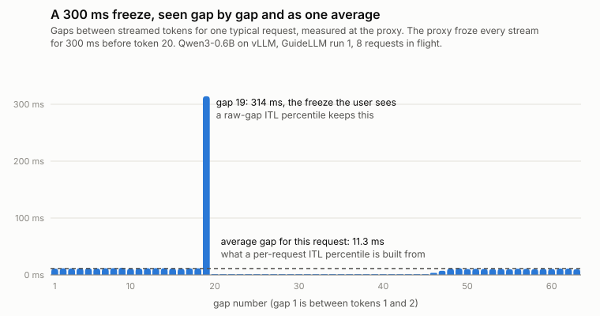

# Same name, different number: three LLM benchmark tools checked against the wire

**Status:** measurement study, code and raw logs public in [llm-bench-wire-audit](https://github.com/dilipna/llm-bench-wire-audit). Checked 2026-10-31: both comparison tables below regenerate exactly from the raw logs with `python compare.py results/clean` and `results/stall`.
**Scope of the evidence:** one model on one 4 GB laptop GPU, 64 requests per run, 8 in flight. See [Limitations](#limitations).

## Summary

Teams pick serving configurations, compare engines and set latency targets from the numbers that load-testing tools print. I wanted to know whether those numbers describe what actually happened, so I put a logging proxy between three tools (`vllm bench serve`, GuideLLM and NVIDIA AIPerf) and one vLLM server and timestamped every streamed event myself.

Two findings:

1. **Where the tools define a metric the same way, they agree with the wire.** Time to first token is within about 3%; mean inter-token latency, output throughput and end-to-end latency are within about 1%.
2. **Some metrics share a name but are different statistics,** and the difference is large enough to change a decision. GuideLLM's TPOT includes the first token and reads 18% higher. Inter-token latency (ITL) is either a percentile over every gap between tokens or a percentile over one average per request. When I froze every stream for 300 ms, the first kind reported p99 ITL of about 311 ms and the second about 16 ms, for the same traffic.

Neither is a bug: GuideLLM's maintainers documented both choices ([#1144](https://github.com/vllm-project/guidellm/issues/1144), [#1145](https://github.com/vllm-project/guidellm/issues/1145)). What this adds is the size of the effect, measured independently, and a test that shows when it matters.



## 1. Why this matters

Inter-token latency is the number behind "does the stream feel smooth", and it is common to set a target on its p99. If one tool's p99 ITL is a percentile over per-request averages, a stall that every user sees once per response barely moves it. A team that switches tools, or compares an engine benchmarked with one tool against another benchmarked with a different one, can conclude that a regression appeared or vanished when only the definition changed.

## 2. Method

`wire_proxy.py` sits between the tool and the server and logs, per request, the arrival time and the arrival time of every streamed event. `wire_metrics.py` recomputes TTFT, ITL, TPOT, end-to-end latency and throughput from that log with the definitions written at the top of the file, so they can be argued with. `compare.py` lines each tool's own report up against the wire for the same run.

| | |
|---|---|
| Tools | `vllm bench serve` (vLLM main `90c4a1a73e`), GuideLLM `0.9.0.dev85` (main `0a883e7b`), AIPerf `0.13.0` |
| Server | unmodified vLLM main, Qwen3-0.6B fp16, RTX 3050 Ti laptop GPU (4 GB) |
| Workload | 64 requests, 128 input and 64 output tokens, 8 in flight, streaming `/v1/completions` |
| Runs | 5 per tool without faults, 3 per tool with the stall |

Each tool generates its own prompts, so every comparison is a tool against the wire for its own run, never one tool against another.

## 3. Result: same definition, same answer

Mean gap between the tool's report and the wire over 5 runs, worst single run in brackets ([full tables](https://github.com/dilipna/llm-bench-wire-audit/blob/main/results/clean_comparison.md)):

| metric | `vllm bench serve` | GuideLLM | AIPerf |
| --- | ---: | ---: | ---: |
| TTFT mean | +2.6% (+3.0%) | +0.7% (+0.9%) | +1.3% (+1.5%) |
| TTFT p99 | +1.4% (+1.5%) | +0.3% (+0.6%) | +2.0% (+3.6%) |
| mean inter-token latency | +0.1% (+0.1%) | -0.0% (-0.1%) | +0.0% (+0.0%) |
| end-to-end latency | not reported | +0.1% (+0.1%) | +0.2% (+0.3%) |
| output tokens/s | -0.1% (-0.1%) | +0.0% (+0.0%) | -0.1% (-0.2%) |

`vllm bench serve` reports about 3 ms more TTFT than the wire in every run. I did not isolate the cause; client time between taking its timestamp and the request reaching the proxy is the likely one.

## 4. Result: same name, different statistic

**TPOT.** GuideLLM's `time_per_output_token_ms` is end-to-end latency divided by output tokens, so it includes the first token. `vllm bench serve` and AIPerf exclude it. On this workload GuideLLM reports 12.90 ms against 10.93 ms on the wire with the exclusive definition: **+18.1%**. The gap should grow as outputs get shorter; I only measured 64 output tokens.

**Inter-token latency.**

| tool | metric | a percentile over |
| --- | --- | --- |
| `vllm bench serve` | `itl` | every gap between streamed events |
| AIPerf | `inter_chunk_latency` | every gap between streamed events |
| AIPerf | `inter_token_latency` | one average per request |
| GuideLLM | `inter_token_latency_ms` | one average per request, weighted by token count |

Each matches the wire for what it is: GuideLLM's p99 equals the p99 of per-request mean gaps (weighted by gap count) to within 0.03 ms in all five runs, and AIPerf's per-request p99 matches within 1%. Without any fault the two conventions were already 13% apart at p99 (17.58 ms per request vs 15.56 ms raw for GuideLLM's runs).

## 5. Result: what a stall looks like under each definition

The proxy froze every stream for 300 ms before token 20 ([full tables](https://github.com/dilipna/llm-bench-wire-audit/blob/main/results/stall_comparison.md)). The chart at the top is one typical request from GuideLLM run 1: gaps of about 12 ms, one gap of 314 ms, then about 26 near-zero gaps as the tokens held during the freeze arrive together. Its average gap is 11.3 ms, lower than its typical gap before the stall, so an average cannot tell this request from one that never stalled.

| p99 inter-token latency with the stall | tool reports | wire |
| --- | ---: | ---: |
| `vllm bench serve` `itl` (raw gaps) | 311.2 ms | 311.2 ms |
| AIPerf `inter_chunk_latency` (raw gaps) | 312.5 ms | 312.5 ms |
| AIPerf `inter_token_latency` (per request) | 15.6 ms | 15.6 ms |
| GuideLLM `inter_token_latency_ms` (per request) | 16.6 ms | 313.1 ms (raw gaps) |

Mean per-token time moved by less than 0.5 ms for every tool. GuideLLM's maintainers have said individual token events are too noisy to read from a client ([#1145](https://github.com/vllm-project/guidellm/issues/1145)), which is a fair position for its purpose; the consequence is that its ITL should not be used to look for stalls or compared with another tool's ITL.

## 6. What I would tell a team using these tools

- Before comparing ITL or TPOT across tools, engines or reports, write down which definition each number uses. TTFT, throughput and mean ITL are safe to compare; p99 ITL and TPOT are not.
- To catch stalls or judge streaming smoothness, use a percentile over raw gaps (`vllm bench serve` `itl`, AIPerf `inter_chunk_latency`) or the largest gap per request. A per-request average will not show them.
- If a latency target is written in GuideLLM's TPOT, it is about 2 ms per token stricter here than the same number in the other tools, and the difference depends on output length.
- When a benchmark result surprises you, a proxy log of event arrival times settles it in minutes. The one used here is 134 lines of Python.

## Limitations

- One model, one small GPU, loopback networking, 64 requests per run, 5 runs (3 with the stall). Other concurrencies, output lengths, models and real networks may give different gaps.
- "The wire" means event arrival times at the proxy, not when the GPU produced each token. The proxy is in the path of every tool, so absolute latencies include its overhead; the comparison is tool against proxy for the same run.
- Three tools, one version each. No claim about others or later versions.
- A first trial run of AIPerf had a slow first wave of requests (TTFT p90 near 1.7 s) that did not recur in the measured runs. I did not find the cause, so it is not in the data.

## Related work in the same area

- [GuideLLM #1406](https://github.com/vllm-project/guidellm/pull/1406) (my PR, open): non-streaming requests were counted as 0 ms ITL samples, which pulled the distribution down. Another contributor's [#1523](https://github.com/vllm-project/guidellm/pull/1523) names it as the fix for those zeros.
- [AIBrix routing case study](../aibrix-routing/): a router that averaged latency over a pod's lifetime, the same averaging problem in a different place.

## Reproduce

```
git clone https://github.com/dilipna/llm-bench-wire-audit && cd llm-bench-wire-audit
python compare.py results/clean     # section 3 and 4 tables, from the raw logs
python compare.py results/stall     # section 5 table
python /path/to/this/folder/chart/make_chart.py results/stall/gl_1.jsonl   # the chart
```

Re-running the experiment itself needs Docker and a GPU: `run_audit.sh`, `run_aiperf.sh` and `run_stall.sh` in that repo are the exact scripts used.

I used an AI assistant while building the proxy and writing this up. I ran the experiments, checked the numbers against the raw logs, and re-ran everything after my first harness left stale requests in a log.
